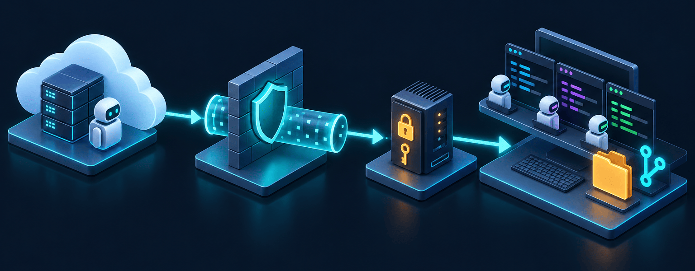
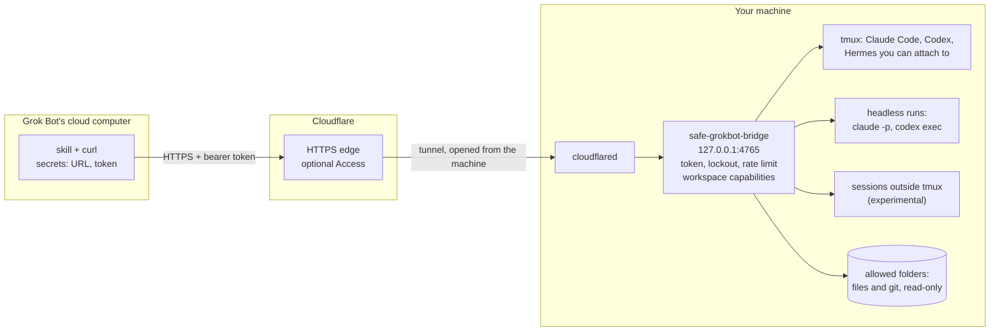

# safe-grokbot-bridge

[](https://github.com/janreges/safe-grokbot-bridge/actions/workflows/ci.yml)
[](LICENSE)


**Let a remote AI agent work on your machines, safely.** `safe-grokbot-bridge` is a small daemon
that gives an agent such as a [Grok Bot](https://x.ai) a narrow, authenticated HTTP API to your
computers. Through it the agent can read your project folders and git history, see the Claude
Code, Codex and Hermes sessions running there, talk to them, and start new ones.

You keep using your agents as before. The remote agent becomes a coordinator that can hand work to
them and follow up while you are away from the keyboard, for example from your phone.

> [!WARNING]
> **This is remote access to your machine.** Depending on your configuration, the remote agent
> can read files and git history in the folders you expose, and through the coding agents it
> starts or messages it can make the machine run programs and commands and change files: with
> the agents' permission prompts, or without them where you allow that. Use the bridge
> deliberately, only where this is acceptable, and grant as little as the work needs. Run it,
> together with the agents it drives, in an isolated environment such as a virtual machine, a
> dedicated WSL 2 distribution or a separate computer, not on your primary workstation with your
> personal data and credentials. See [Where to run it](docs/deployment.md#where-to-run-it).

## How it works





1. The bridge listens on `127.0.0.1` only. `cloudflared` opens an outbound tunnel, so no port is
   opened on the machine. (A public address with TLS and key pinning works too.)
2. The bot calls the API with `curl` and a bearer token kept in a Grok secret. Every request is
   authenticated, rate limited and checked against the folders you allowed.
3. The bridge lists, starts and drives agent sessions there, and serves files and git history
   read-only. The bot long-polls a session until the agent has answered.

## Features

- **Agent sessions.** List, start, message and stop Claude Code, Codex CLI and Hermes Agent
  sessions, or any other terminal program in tmux.
  - **tmux:** the agent runs in a live terminal you can attach to at any time
    (`tmux attach -t …`).
  - **Headless:** every message is one non-interactive run, continued by the agent's session id.
  - **Start options:** model, reasoning effort, permission bypass (only where you allow it),
    resume of an earlier conversation, and `keep_alive: false` to close a session once it has
    answered.
  - **Reliable state:** state comes from Claude Code's own status, per-session turn-complete hooks
    and terminal activity, so the client knows when an agent is working, waiting for an answer or
    done. It long-polls instead of guessing.
- **Read-only project access.** Directory listings (respecting `.gitignore`), text files by line
  range, `git status`, `log`, `diff` and `show`. The file endpoints never serve secrets such as
  `.env` files and private keys. Git output is not filtered, so anything committed to a
  repository you expose is visible.
- **Security first.**
  - 256-bit bearer tokens (only their hashes are stored), with per-IP lockout after failed
    attempts and per-token rate limits.
  - Per-folder capabilities (`files`, `git`, `sessions`, `input`, `start`).
  - TLS required on any public address. A self-signed certificate with public-key pinning works
    out of the box, no CA needed.
  - Every request is written to an audit log, and no generic shell endpoint exists.
- **Made for LLM clients.** A complete [OpenAPI 3.1](docs/openapi.json) description. Every
  response says when it is incomplete and what to do next, and a
  [ready-made skill](docs/grok-bot.md) teaches Grok Bot to use it.
- **One binary** for Linux, macOS and Windows. Configuration is one TOML file.

## Quick start

**With Grok Bot and Cloudflare:** follow [Setup with Grok Bot and Cloudflare](docs/setup.md).
You paste one prompt into Grok Bot, which creates the tunnel, and one into Claude Code or Codex
on your machine, which installs and configures the bridge. You only move two secrets by hand.

**With your coding agent:** install the [agent skill](#agent-skill) and tell Claude Code or Codex
*"Set up safe-grokbot-bridge on this machine."* It asks you which folders to expose and what the
bot may do there, then does the rest.

**By hand:**

```bash
# 1. Install: download the archive for your platform from the releases page, or build it
cargo install --locked --git https://github.com/janreges/safe-grokbot-bridge

# 2. Create a config with a fresh token (printed once) and your projects folder as a workspace
safe-grokbot-bridge init --workspace ~/projects

# 3. Allow driving agents there: add "input" and "start" to `allow` in the file `init` wrote
#    (Linux: ~/.config/safe-grokbot-bridge/config.toml,
#     macOS: ~/Library/Application Support/safe-grokbot-bridge/config.toml), then review everything
safe-grokbot-bridge check

# 4. Run it, and publish it with a Cloudflare Tunnel (see docs/deployment.md)
safe-grokbot-bridge serve
```

Then [connect Grok Bot](docs/grok-bot.md), or call the API from anything that speaks HTTP.

Tip: start your agents with `safe-grokbot-bridge launch claude` (or `codex`) instead of `claude`.
They then run in tmux with the bridge's turn hooks, so the remote agent can follow and continue
your sessions.

## Agent skill

This repository is also a plugin marketplace with one skill,
[`safe-grokbot-bridge`](skills/safe-grokbot-bridge/SKILL.md). It teaches Claude Code, Codex and
other coding agents to install the bridge, agree with you on the folders it exposes and what the
bot may do there, write and later change the config, run it as a service, connect the Cloudflare
Tunnel, upgrade it and troubleshoot it. The agent shows you every plan before it applies it,
asks before it widens access, and never handles your secrets.

| Agent | Install |
|---|---|
| Claude Code | `claude plugin install safe-grokbot-bridge --marketplace janreges/safe-grokbot-bridge` (2.1.292 or newer; before that, `claude plugin marketplace add janreges/safe-grokbot-bridge` and `claude plugin install safe-grokbot-bridge@safe-grokbot-bridge`) |
| Codex | `codex plugin marketplace add janreges/safe-grokbot-bridge`, then `codex plugin add safe-grokbot-bridge@safe-grokbot-bridge` |
| Cursor, Gemini CLI, GitHub Copilot, OpenCode and others | `npx skills add janreges/safe-grokbot-bridge -g` |
| Any agent, by hand | Copy `skills/safe-grokbot-bridge/` into the agent's skills folder, such as `~/.claude/skills/` or `~/.agents/skills/` |

Then start a new session and say, for example, *"Set up safe-grokbot-bridge on this machine"* or
*"Let the bot also start agents in ~/projects/app."*

To update the skill later: `claude plugin update safe-grokbot-bridge@safe-grokbot-bridge` in
Claude Code; `codex plugin marketplace upgrade safe-grokbot-bridge`, then the `codex plugin add`
command again in Codex; `npx skills update` elsewhere.

## Using the API

Every request except `GET /healthz` needs `Authorization: Bearer <token>`. All paths are absolute.

```bash
B=https://bridge.example.com; H="Authorization: Bearer $SGB_TOKEN"

curl -sH "$H" $B/v1/info                                  # machine, agents, workspaces, limits
curl -sH "$H" "$B/v1/sessions?path=/home/me/projects/app"  # who is already working there?

# Start Claude Code in tmux with a task, then wait (up to 90 s per call) for the answer
curl -sH "$H" -H 'content-type: application/json' $B/v1/sessions -d @- <<'EOF'
{"cwd": "/home/me/projects/app", "agent": "claude", "prompt": "Run the tests and fix failures."}
EOF
curl -sH "$H" "$B/v1/sessions/sgb-app-claude-3f9a1c?wait=60"   # state, last_message, screen

# Follow up, or answer a permission prompt with keys
curl -sH "$H" -H 'content-type: application/json' $B/v1/sessions/sgb-app-claude-3f9a1c/input \
     -d '{"text": "Also update the changelog."}'
curl -sH "$H" -H 'content-type: application/json' $B/v1/sessions/sgb-app-claude-3f9a1c/input \
     -d '{"keys": ["Enter"]}'

# Read-only access
curl -sH "$H" "$B/v1/files?path=/home/me/projects/app&depth=2"
curl -sH "$H" "$B/v1/files/content?path=/home/me/projects/app/README.md"
curl -sH "$H" "$B/v1/git/log?dir=/home/me/projects/app&limit=10"
```

| Endpoint | Purpose |
|---|---|
| `GET /v1/info` | Machine, version, agents, workspaces and their capabilities, limits |
| `GET /v1/files`, `GET /v1/files/content` | Directory listing, text file by line range |
| `GET /v1/git/{status,log,diff,show}` | Read-only git |
| `GET /v1/sessions` | Sessions in the workspaces you may see |
| `POST /v1/sessions` | Start a session (`cwd`, `agent`, `runner`, `prompt`, `model`, `effort`, `bypass_permissions`, `keep_alive`, `resume`) |
| `GET /v1/sessions/{id}?wait=&lines=` | State, last answer, terminal screen; long-poll while working |
| `POST /v1/sessions/{id}/input` | `text` and/or `keys` |
| `DELETE /v1/sessions/{id}` | Stop a session the bridge started |
| `GET /openapi.json` | The OpenAPI document ([also in the repo](docs/openapi.json)) |

### How sessions work

| Runner | When | How you get answers |
|---|---|---|
| `tmux` | Default when tmux is installed. A live terminal UI; a person can attach. | `last_message` from the turn hook (Claude Code, Codex), plus the terminal `screen` |
| `headless` | Without tmux (e.g. native Windows), or on request. One non-interactive run per message. | `last_message`; progress while the turn runs |
| `external` | Sessions started outside tmux, e.g. in a terminal tab. | Claude Code: state always; with `[experimental] external_sessions` also messaging and answers. Codex: experimental. |

Session states: `working`, `waiting` (a permission prompt or question; read `screen` and answer
with `keys`), `idle`, `finished` (closed after its answer with `keep_alive: false`), `exited`,
`failed`, `unknown`.

The bridge types only into panes where nothing but the agent can receive the text: sessions it
started, and panes whose program is the agent (or a wrapper that ends with it). An agent you
started from a shell inside tmux is listed but not typed into, because text sent after the agent
exits would reach the shell; with `[experimental] external_sessions`, Claude Code and Codex there
take messages through their own inbox or queue instead. `resume` continues a conversation only in
the folder where it was held.

## Security

A token lets its holder make coding agents work on your machine, possibly without permission
prompts if you allow that. Treat it like an SSH key. In short:

- **Isolation:** the agents the bridge drives run with your user's rights. Give them a virtual
  machine, a dedicated WSL 2 distribution or a separate computer that holds only the projects and
  credentials the work needs; see [Where to run it](docs/deployment.md#where-to-run-it).
- **Tokens:** 256-bit, stored as SHA-256 hashes, compared in constant time. A client IP is
  blocked after repeated failures, and each token has a request rate limit.
- **Network:** plain HTTP only on loopback. Publish it through a Cloudflare Tunnel, optionally
  with an Access service token as a second factor, or enable TLS with key pinning.
- **Folders:** capabilities per folder; access is read-only by default. Paths are canonicalized,
  so `..` and symlinks cannot escape.
- **No shell endpoint:** the bridge itself never runs arbitrary commands, and git runs with
  options that keep a repository's own config from executing programs. The coding agents it
  starts do run commands, under their own permission systems.

Read the [threat model](docs/design.md#6-security-model) and [SECURITY.md](SECURITY.md).

## Platform support

| | Linux / WSL 2 | macOS | Windows |
|---|---|---|---|
| API, TLS, files, git, headless sessions | ✓ | ✓ | ✓ |
| tmux sessions | ✓ | ✓ | best effort with [psmux](https://github.com/psmux/psmux) (sessions the bridge started, one pane each) |
| External Claude Code sessions | ✓ | ✓ | ✓ |

## Documentation

- [Setup with Grok Bot and Cloudflare](docs/setup.md): the guided setup, with prompts to paste
- [Configuration reference](docs/configuration.md)
- [Deployment: Cloudflare Tunnel, VPS, running as a service](docs/deployment.md)
- [Connecting Grok Bot, with a ready-made skill](docs/grok-bot.md)
- [Agent skill for Claude Code and Codex](skills/safe-grokbot-bridge/SKILL.md): how a coding agent
  sets up and maintains the bridge
- [Design and security model](docs/design.md)
- [OpenAPI document](docs/openapi.json)

## Troubleshooting

- **`agent_exited` when starting a session.** Run the agent once by hand in that folder. It may
  need a login, or the agent's `args` in the config contain a flag it does not know.
- **A new session waits on a "trust this folder" dialog.** That is normal on the first start in a
  folder. Answer with `{"keys": ["Enter"]}`.
- **The bridge runs as a service and cannot find `claude` or `codex`.** Services get a minimal
  `PATH`. Set absolute `command` paths in `[agents.*]`, or set `PATH` in the service definition,
  and run `safe-grokbot-bridge check` in the same environment.
- **A Claude Code session outside tmux does not react to messages (experimental).** Sessions
  that run without permission prompts hold messages from other processes for local approval. Set
  `"crossSessionInbound": "accept"` in that session's Claude Code settings.

## Contributing

Issues and pull requests are welcome. See [CONTRIBUTING.md](CONTRIBUTING.md).

## License

[MIT](LICENSE)

safe-grokbot-bridge is an independent project. It is not affiliated with, endorsed by or
sponsored by xAI, Cursor, Anthropic, OpenAI, Nous Research or Cloudflare. Grok, Cursor, Claude,
Claude Code, Codex, Hermes and Cloudflare are trademarks of their respective owners.
