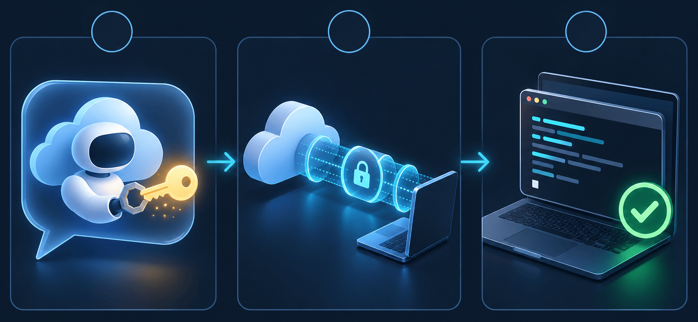
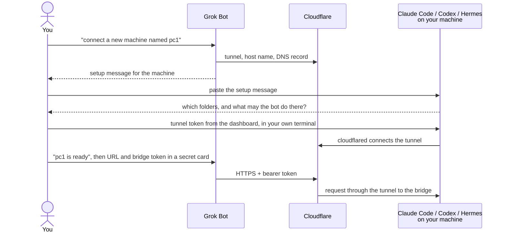

# Setup with Grok Bot and Cloudflare



This guide connects a [Grok Bot](https://x.ai) to one of your machines. Most of the work is done
by agents: Grok Bot creates the Cloudflare Tunnel, and a coding agent on your machine (Claude
Code, Codex or Hermes) installs and configures the bridge. You answer their questions and move
two secrets by hand.

| Who | Does what |
|---|---|
| **Grok Bot**, in the cloud | Creates the tunnel and its host name through the Cloudflare API, writes the setup message for your machine, and later uses the bridge |
| **Claude Code, Codex or Hermes**, on your machine | Agrees with you on the folders to expose, installs the bridge and `cloudflared`, writes the config, starts both as services, verifies |
| **You** | Install two skills, create a Cloudflare API token, and copy two secrets: the tunnel token to the machine, the bridge token to Grok Bot |

Secrets never go through a chat. Chats are stored, and a tunnel token lets whoever holds it run
your tunnel and receive the bot's requests. Each step says where a secret goes.



> [!WARNING]
> The bridge gives Grok Bot remote access to the machine: it can read the folders you expose and
> make the coding agents there run commands and change files. Set it up on a machine meant for
> that, such as a virtual machine or a dedicated WSL 2 distribution, not on your primary
> workstation. See [Where to run it](deployment.md#where-to-run-it).

## Before you start

- A **Grok Bot**. Bots have a cloud computer with a shell, and a *secure secret card* that turns
  values into environment variables.
- A **Cloudflare account** with a domain whose DNS is on Cloudflare. The free plan is enough.
- The **machine**: preferably an isolated one (see above) with Linux, WSL 2 or macOS, Claude Code,
  Codex or Hermes logged in, `tmux` (for live sessions) and `git`. For native Windows see [deployment](deployment.md#windows). It needs
  no open inbound port, but `cloudflared` connects out to Cloudflare on port **7844** (TCP or
  UDP): a firewall that allows only outbound 443 blocks the tunnel.
- Pick a **name** for the machine and a **host name** for its bridge. The examples use `pc1` and
  `pc1-bridge.example.com`. Replace them everywhere.

## Quick setup (recommended)

Two skills do the work. One teaches Grok Bot to use the bridge and to connect new machines, the
other teaches the coding agent on the machine to install and configure the bridge.

### 1. Install the skills

**In Grok Bot**, paste this into a chat with your main bot:

```text
Download https://raw.githubusercontent.com/janreges/safe-grokbot-bridge/main/skills/safe-grokbot-bridge-client/SKILL.md
with curl and save its content, unchanged, as a skill named safe-grokbot-bridge-client.
Then tell me how to enable it for my other bots.
```

If your bot cannot save a skill from a file, open that link, copy the whole file, and paste it
into the chat with *"Save this as a skill named safe-grokbot-bridge-client."* Enable the skill
for every bot that should work with your machines.

**On the machine**, preferably a virtual machine or a dedicated WSL 2 distribution (see the
warning above), install the other skill into your coding agent, then start a new session so that
the agent loads it:

<details>
<summary><b>Claude Code</b></summary>

```bash
claude plugin install safe-grokbot-bridge --marketplace janreges/safe-grokbot-bridge
```

This needs Claude Code 2.1.292 or newer. Older versions: `claude plugin marketplace add
janreges/safe-grokbot-bridge`, then `claude plugin install safe-grokbot-bridge@safe-grokbot-bridge`.

</details>

<details>
<summary><b>Codex</b></summary>

```bash
codex plugin marketplace add janreges/safe-grokbot-bridge
codex plugin add safe-grokbot-bridge@safe-grokbot-bridge
```

</details>

<details>
<summary><b>Hermes Agent</b></summary>

```bash
hermes skills inspect janreges/safe-grokbot-bridge/skills/safe-grokbot-bridge
hermes skills install janreges/safe-grokbot-bridge/skills/safe-grokbot-bridge --force
```

Hermes blocks skills from community sources that set up services, tunnels and `sudo` steps,
which is exactly this skill's job. Read it with `inspect` first; `--force` installs it anyway.

</details>

<details>
<summary><b>Other agents</b> (Cursor, Gemini CLI, GitHub Copilot, OpenCode, …)</summary>

```bash
npx skills add janreges/safe-grokbot-bridge --skill safe-grokbot-bridge -g
```

</details>

### 2. Connect the machine

**2a. In Grok Bot**, in a new chat:

```text
Use the safe-grokbot-bridge-client skill to connect a new machine named pc1.
```

The bot asks for your Cloudflare domain and a host name for the machine. The first time, it also
asks you for a Cloudflare API token and says which permissions it needs. Then it creates the
tunnel and gives you a short setup message for the machine.

**2b. On the machine**, paste that message into Claude Code, Codex or Hermes. The agent:

- asks which folders the bot may use and what it may do there, and shows you the plan;
- installs the bridge and `cloudflared`, writes the config and starts both as services;
- asks you to save the tunnel token, which you copy from the Cloudflare dashboard, in your own
  terminal;
- checks that everything answers, and puts the bridge token on your clipboard.

Then go back to Grok Bot and say *"pc1 is ready"*. It asks you to paste the URL and the bridge
token into a secure secret card, and tests the connection in a new chat. From then on you can
ask it things like *"On pc1, start Claude Code in ~/projects/app and let it fix the failing
tests, then tell me what it changed."*

For the next machine, repeat step 2 with another name.

## Setup step by step

These steps do by hand what the skills do: for agents without skills, or to see every detail.

## Step 1: Give Grok Bot access to Cloudflare (once)

Create an API token that can manage tunnels and DNS, and nothing else:

1. In the Cloudflare dashboard open **My Profile → API Tokens → Create Token → Create Custom
   Token**.
2. Permissions:
   - *Account* · *Cloudflare Tunnel* · *Edit*
   - *Zone* · *Zone* · *Read* and *Zone* · *DNS* · *Edit*, with *Zone Resources* set to your
     domain only
   - optional, for the second factor in step 5: *Account* · *Access: Apps and Policies* · *Edit*
     and *Account* · *Access: Service Tokens* · *Edit*
3. Copy the token. Also copy your **Account ID** (on the account's overview page).

Now paste this into a chat with your main bot:

```text
Create a secure secret card with two secrets: CLOUDFLARE_API_TOKEN and CLOUDFLARE_ACCOUNT_ID.
I will paste the values into the card, not into this chat.
```

Paste the two values into the card it shows. Secrets are shared by all bots of your account. A
chat started before the secrets were saved may not see them, so continue in a new chat.

> **Alternative:** if your Grok plan supports custom connectors, you can instead connect
> Cloudflare's own MCP server, `https://mcp.cloudflare.com/mcp`, and grant it the same
> permissions when it asks. The prompt in step 2 works with either.

## Step 2: Let Grok Bot create the tunnel

Paste this into a new chat. Replace `pc1`, `pc1-bridge.example.com` and `example.com` first.

````text
Create a Cloudflare Tunnel for safe-grokbot-bridge on my machine "pc1".

Use the Cloudflare API from your shell with the secrets $CLOUDFLARE_API_TOKEN and
$CLOUDFLARE_ACCOUNT_ID (or the Cloudflare connector, if it is connected). Steps:

1. Find the zone id of example.com: GET /client/v4/zones?name=example.com
2. If a tunnel named "sgb-pc1" or a DNS record for pc1-bridge.example.com already exists, show it
   and ask me before changing anything.
3. Create a remotely managed tunnel:
   POST /client/v4/accounts/$CLOUDFLARE_ACCOUNT_ID/cfd_tunnel
   {"name": "sgb-pc1", "config_src": "cloudflare"}
4. Route the host name to the bridge, which listens on the machine's loopback:
   PUT /client/v4/accounts/$CLOUDFLARE_ACCOUNT_ID/cfd_tunnel/<tunnel id>/configurations
   {"config": {"ingress": [
     {"hostname": "pc1-bridge.example.com", "service": "http://127.0.0.1:4765"},
     {"service": "http_status:404"}]}}
5. Create the DNS record:
   POST /client/v4/zones/<zone id>/dns_records
   {"type": "CNAME", "name": "pc1-bridge.example.com",
    "content": "<tunnel id>.cfargotunnel.com", "proxied": true}

Rules: send the API token only in the Authorization header, never print it. Do NOT print the
tunnel token (result.token) either: I will copy it from the Cloudflare dashboard myself.

Finally tell me the tunnel name and id, and the host name.
````

Grok Bot answers with the tunnel's name and id. Until the machine connects, the host name
answers with a Cloudflare error page (`530`), which is expected.

## Step 3: Set up the machine

**3a. Save the tunnel token (in your own terminal).** In the Cloudflare dashboard, open the
tunnel `sgb-pc1` (under *Zero Trust → Networks → Tunnels*) and choose to install a connector.
The command shown there ends with the tunnel token, the long string after `install`. Copy only
the token, then run this in a terminal on the machine and paste the token at the prompt. Nothing
is echoed or saved in any history:

```bash
mkdir -p -m 700 ~/.config/safe-grokbot-bridge
bash -c 'umask 077; read -rsp "Tunnel token: " t && echo && [ -n "$t" ] && rm -f ~/.config/safe-grokbot-bridge/tunnel-token && printf "%s" "$t" > ~/.config/safe-grokbot-bridge/tunnel-token'
```

The command runs in Bash also from zsh, the default shell on macOS. Only you can read the file,
and nothing is written when the input is empty.

**3b. Let your coding agent do the rest.** If you installed the
[agent skill](../README.md#agent-skills), start Claude Code or Codex and say *"Set up
safe-grokbot-bridge for the Cloudflare Tunnel sgb-pc1 at https://pc1-bridge.example.com."* It
asks you which folders to expose and what the bot may do there, and continues as below.

Without the skill, start Claude Code or Codex in your home folder and paste this prompt. Replace
the host name and fill in the folders you want to expose:

````text
Set up safe-grokbot-bridge on this machine, so that my Grok Bot can reach it through the
Cloudflare Tunnel "sgb-pc1" at https://pc1-bridge.example.com.

Rules:
- Never print, echo or read back secrets in this conversation: the tunnel token in
  ~/.config/safe-grokbot-bridge/tunnel-token and the bridge token that `init` creates. Keep
  secrets in files with mode 600.
- Ask me before you use sudo or change anything outside ~/.config, ~/.local, ~/.cargo and
  ~/Library.

Steps:
1. Install safe-grokbot-bridge: the archive for this OS and CPU from the latest release of
   https://github.com/janreges/safe-grokbot-bridge (for example with `gh release download`;
   check its .sha256 file), or build it with
   `cargo install --locked --git https://github.com/janreges/safe-grokbot-bridge`.
   Put the binary on my PATH and check `safe-grokbot-bridge --version`.
2. Install cloudflared from Cloudflare's official packages for this OS, as described on
   https://developers.cloudflare.com/cloudflare-one/networks/connectors/cloudflare-tunnel/downloads/
   Check `cloudflared --version`: `--token-file` below needs 2025.4.0 or newer.
3. Create the config without showing the token, so that the token file is private from the
   start:
   `(umask 077; rm -f ~/.config/safe-grokbot-bridge/bridge-token.txt; safe-grokbot-bridge init --workspace <first folder> > ~/.config/safe-grokbot-bridge/bridge-token.txt)`
   Edit the config file it created (`safe-grokbot-bridge check` prints its path): keep
   `listen = "127.0.0.1:4765"`, and set these workspaces:
   - /home/me/projects: allow files, git, sessions, input, start; allow_bypass_permissions = false
   The config file explains every option; the full reference is docs/configuration.md in the
   repository.
4. Run `safe-grokbot-bridge check` until it prints OK.
5. Run both programs as services of my user, as in the section "Running as a service" of
   docs/deployment.md in the repository: systemd user units with `loginctl enable-linger` on
   Linux and WSL 2 (WSL 2 needs systemd enabled in /etc/wsl.conf), launchd agents on macOS.
   - `safe-grokbot-bridge serve`, with a PATH that contains claude, codex, node, git and tmux,
     and `KillMode=process` in its systemd unit, so that its tmux sessions survive restarts;
   - `cloudflared tunnel --no-autoupdate run --token-file ~/.config/safe-grokbot-bridge/tunnel-token`
     (an absolute path; the token must not appear on a command line).
   On WSL 2 and macOS, tell me what else keeps them running after a reboot (same section).
6. Verify, and show me the output:
   - `curl -s http://127.0.0.1:4765/healthz` and `curl -s https://pc1-bridge.example.com/healthz`
     both print `ok`;
   - `curl -s -o /dev/null -w '%{http_code}\n' https://pc1-bridge.example.com/v1/info` prints 401.
7. Tell me the URL, the path of bridge-token.txt, and how to read the logs of both services.
````

The agent asks before it uses `sudo`. On Linux, `cloudflared` from Cloudflare's package
repository needs it once for the installation.

On Linux the two services start with the machine. A WSL 2 distribution runs only while Windows
keeps it running, and macOS starts them when you log in: see [when the bridge
runs](deployment.md#when-the-bridge-runs).

## Step 4: Connect Grok Bot to the bridge

Paste this into a chat with your main bot:

```text
Create a secure secret card with two secrets: SGB_PC1_URL and SGB_PC1_TOKEN.
I will paste the values into the card, not into this chat.
```

Paste `https://pc1-bridge.example.com` as the URL. For the token, open
`~/.config/safe-grokbot-bridge/bridge-token.txt` on the machine and copy the token, the value that
starts with `sgb_`. Then delete that file:

```bash
rm ~/.config/safe-grokbot-bridge/bridge-token.txt
```

Install the bot's skill as in [step 1 of the quick setup](#1-install-the-skills), if you have
not yet. It finds your machines by their secrets, so nothing in it needs editing.

Then test it, in a new chat:

```text
Use the safe-grokbot-bridge-client skill: show me what machine pc1 offers (GET /v1/info) and
which agent sessions run there.
```

The bot answers with the machine's workspaces, agents and sessions. From now on you can ask it
things like *"On pc1, start Claude Code in ~/projects/app and let it fix the failing tests, then
tell me what it changed."*

## Step 5 (optional): a second factor with Cloudflare Access

With an Access application in front of the host name, requests without a valid Cloudflare
service token never reach your machine. Paste this into a chat with your bot (the API token
needs the Access permissions from step 1):

````text
Protect pc1-bridge.example.com with Cloudflare Access, using a service token:

1. Create a service token named "grok-sgb-pc1" (POST /client/v4/accounts/<account id>/access/service_tokens).
2. Create a self-hosted Access application for the domain pc1-bridge.example.com, with one
   policy whose action is "Service Auth" (decision "non_identity") and that includes only this
   service token.
3. Store the token's client_id and client_secret as the secrets SGB_PC1_ACCESS_ID and
   SGB_PC1_ACCESS_SECRET through a secure secret card. Do not print them in the chat.
4. Check that `sgb pc1 GET /v1/info` still works, and that a request without the two headers
   gets 403 from Cloudflare.
````

The skill's `sgb` helper sends the two headers automatically once these secrets exist.

## More machines

Repeat steps 2 to 4 for every machine with its own name (`pc2`, `vps`, …), host name and token.
Step 1 is needed only once.

## When something does not work

| Symptom | Check |
|---|---|
| `530` or `1033` from the host name | The tunnel has no connector: `cloudflared` is not running on the machine, or the token file is wrong. Read its service log. |
| `cloudflared` logs timeouts or `failed to dial` | A firewall blocks outbound port 7844 (TCP and UDP) to Cloudflare. Allow it; see Cloudflare's [firewall requirements](https://developers.cloudflare.com/cloudflare-one/networks/connectors/cloudflare-tunnel/configure-tunnels/tunnel-with-firewall/). |
| `502` from the host name | `cloudflared` runs, but the bridge does not answer on `127.0.0.1:4765`: is its service running, and is `listen` unchanged? |
| `401 unauthorized` | Grok uses a wrong token. Compare the secret with the token you created; create a new one with `safe-grokbot-bridge token` if it is lost. |
| `429` with `Retry-After` | Too many failed attempts from the bot's address, or too many requests. Wait as long as `Retry-After` says. |
| A Cloudflare challenge page | Bot Fight Mode or a WAF rule blocks non-browser clients; see [deployment](deployment.md#option-a-cloudflare-tunnel-recommended). |
| The bot says a secret is missing | Secrets are read when a chat starts. Start a new chat. |

The [deployment guide](deployment.md) covers the same setup done by hand, a public IP with TLS
instead of a tunnel, and services on every platform.
